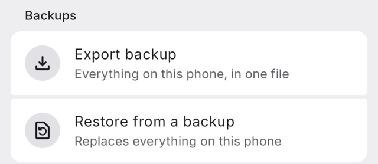
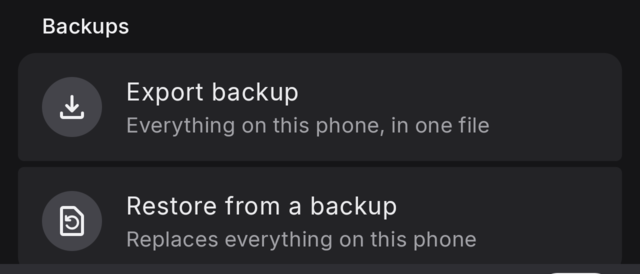

Your training is stored on your phone. There are two ways to back it up.

| | Backup file | Android's own backup |
| --- | --- | --- |
| What | One file you save where you like | The app's data, in your Google account |
| When | When you tap **Export backup** | By Android, about once a day |
| Restore | **Settings → Restore from a backup** | When the app is installed on a phone signed in to that account |

**Rely on the backup file.** Keep a recent one somewhere off the phone, such as Drive or your
computer. Treat Android's backup as a fallback. It runs only when the phone is idle, charging and on
Wi-Fi, and it needs "Backup by Google One" switched on in the phone's Google settings.

## What's in a backup

Everything you made in the app: programs and their Changes, every session (one in progress
too), training days, gyms and equipment, the exercise library with your edits, goals,
bodyweight, your training style and your settings.

**Never in a backup:** your Claude key and your sign-in for the connector. They are stored so that
only this phone can read them, so you enter them again after a move. The connector's account copy is not a backup, and it is
never copied back to a phone.

## Export

**Settings → Export backup**, then choose where to save it. The file is named like
`overloadvector-backup-2026-11-26.json`. It holds your training, so keep it somewhere private.

## Restore

**Settings → Restore from a backup**, then pick the file. The app asks "Replace everything on this
phone?". Restoring replaces all the data on the phone with the file's. Nothing is merged. A file the
app can't read says why, and nothing changes.

## Move to a new phone

1. On the old phone, **Export backup** to Drive, or copy the file to your computer.
2. On the new phone, [install Overload Vector](/docs/getting-started/).
3. On Setup's first screen, tap **Restore from a backup** and pick the file.
4. Enter your Claude key again, or **Connect Claude** and tap **Use this phone** when asked.

If you rely on Android's backup instead, sign in to the same Google account while setting up the new
phone, restore from its backup, then install Overload Vector. Android puts the data back as the app is
installed.

Uninstalling the app deletes its data from the phone.
