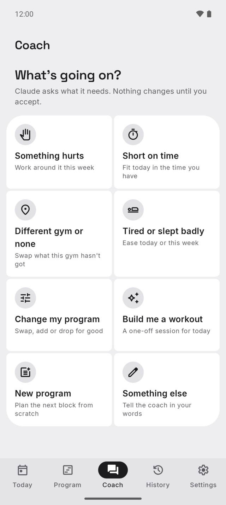
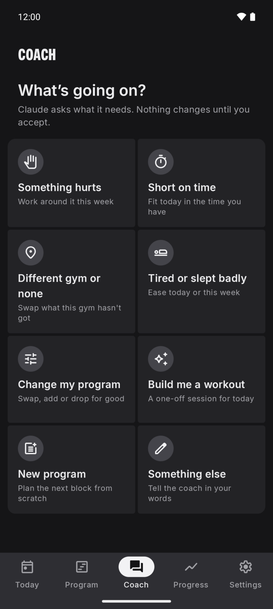
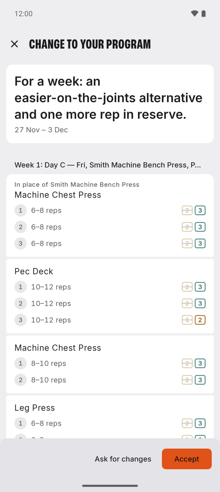
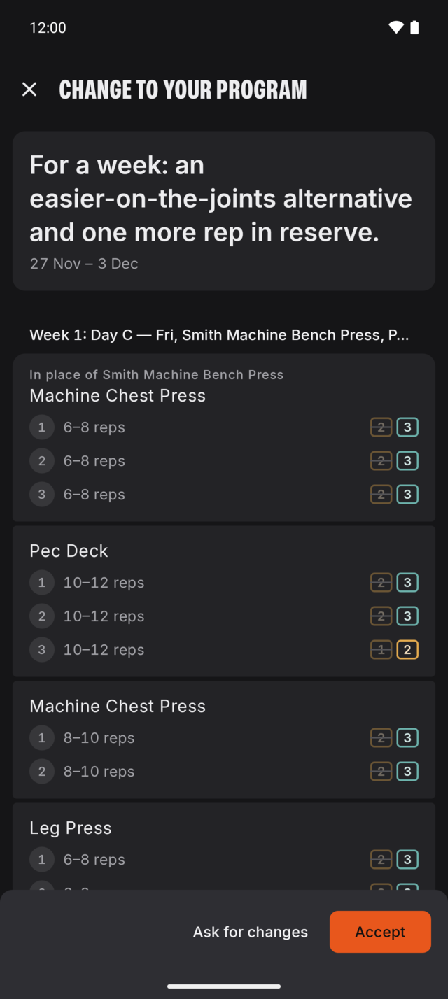
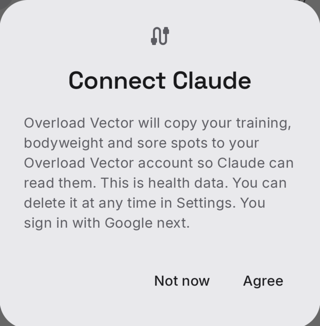
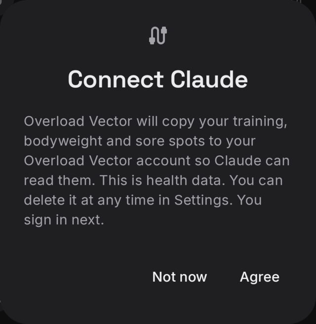

When the plan meets real life (a sore wrist, a short evening, a hotel gym), Claude can propose what
to do. It reads your program and your recent training, and it proposes one of:

- **A Change** to your program, for a few days or for good.
- **A workout** for today, outside the program.
- **A new program.**
- Plain words, when the plan can stand as it is.

**Nothing changes until you accept it.** You see the difference first, and you can revert an accepted
Change later.

There are two ways to use Claude. Both are optional: logging, programs and progression work without
either.

| | Your own API key | The connector |
| --- | --- | --- |
| Where you talk to Claude | In Overload Vector's **Coach** tab | In the Claude app or on claude.ai |
| You need | An Anthropic API key | A Claude account |
| Who you pay | Anthropic, for what you use | Your Claude plan |
| Your training goes | From the phone to Anthropic, when you check in | To your Overload Vector account, which Claude reads |

The [privacy policy](/privacy/) says exactly what is sent.

## Check-ins with your own key

1. Create an API key in the [Claude Console](https://console.anthropic.com/), and set a monthly
   spend limit there.
2. In Overload Vector, open **Settings → Claude key**, paste the key and save. The key is checked,
   then stored encrypted on your phone. It is never in a backup.
3. Open **Coach** and pick what's going on: **Something hurts**, **Short on time**, **Different gym
   or none**, **Tired or slept badly**, **Change my program**, **Build me a workout**, **New
   program** or **Something else**.

Claude asks a few short questions, one on each screen. Tap an answer or type your own. At the end
you review what it proposes: accept it, ask for changes or drop it.

For a **New program** you can attach a spreadsheet (`.xlsx` or `.csv`), a PDF or a photo of a program
you have, and Claude turns it into one you can run.

Settings shows what the month's check-ins have cost, as an estimate. **Remove** forgets the key.

## The connector

With the connector, you talk to Claude in its own app, and its proposals appear in Overload Vector.

1. In Overload Vector, open **Settings → Connect Claude**. Read what will be copied, tap **Agree**
   and sign in with Google. If we have invited your email address, you can type it instead and enter
   the code mailed to you. Sign in with the code before you ever use Google with that address, or the
   two stay separate accounts.
2. Tap **Add to Claude**. It copies a client ID and opens Claude's dialog for adding a custom
   connector. The server address is `https://mcp.overloadvector.com/mcp`. Paste the client ID under
   **Advanced settings**, in **Use your own OAuth client**.
3. When Claude asks, sign in the same way as in the app.
4. Ask Claude about your training, such as "My wrist hurts today. What should I change?"

What Claude proposes shows on **Today** as a card the next time you open the app. Tap **Review**,
then accept or decline. A proposal you leave alone expires after 30 days.

Your phone copies new training to the account after each session and when you open the app. Claude
can read the copy and propose; it can't change anything in your app.

- **Disconnect** stops the copying. The copy stays.
- **Delete my account data**, in Settings, deletes the copy, any waiting proposals and your Overload
  Vector account. The training on your phone stays. Also remove Overload Vector from Claude's
  connectors.

The app asks you to sign in again after a year, and Claude after 90 days.

During the beta, signing in to the connector may be limited to invited testers. If Google won't let
you in, [write to us](/contact/).

## The coach line

When your log shows a pattern, such as a lift that hasn't moved in three sessions or a day you keep
missing, Today shows one line about it with **Check in**. It needs no key to show, and it changes
nothing by itself.

## Your training style

**Settings → Training style** holds how you like to train: your goal, weekly sets per muscle,
effort, rep ranges, the principles you follow and, if you like, your age band and any aches. New
programs and every check-in follow it.

Claude can be wrong, and nothing it says is medical advice. For pain that doesn't pass, see a doctor
or physio.
