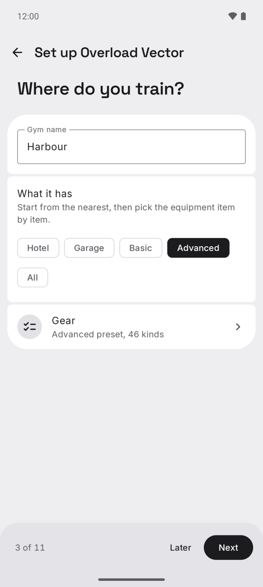
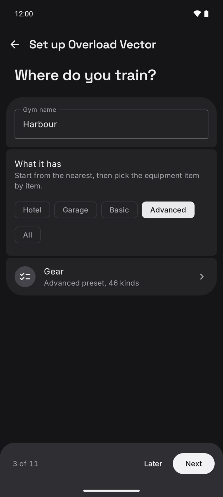
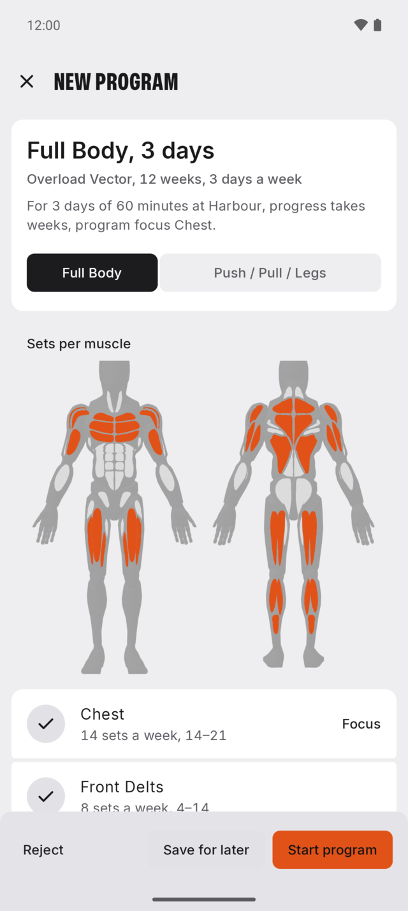
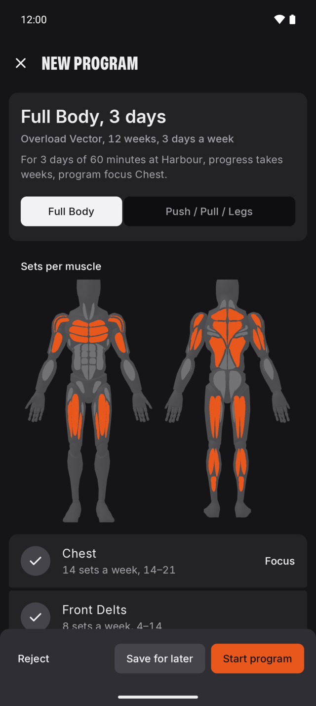
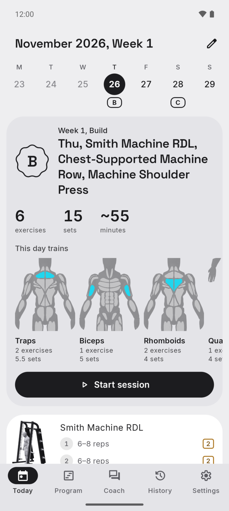
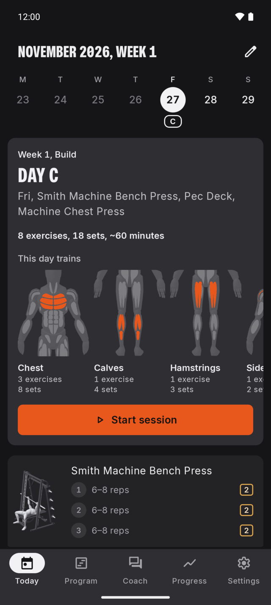

Overload Vector runs a periodized strength program, logs each session and works out the next
weights. It needs no account, and your training stays on your phone.

## Install the beta

Overload Vector is in beta and free. It needs **Android 8.0 or newer** and a 64-bit ARM processor,
which nearly every recent phone has.

1. On the phone, open the
   [latest release](https://github.com/villekivela/overloadvector-releases/releases/latest) in the
   browser.
2. Download the `.apk` file and open it. The first time, Android asks you to allow installs from
   your browser.
3. Open Overload Vector.

Updates come through the app. A banner on **Today** offers each new version. Tap it and confirm
Android's "Update this app?". To stop the check, switch off **Settings → Check for updates**.

### From Google Play

Invited to the test on Google Play? Open the invitation link on the phone, accept it and install
Overload Vector from the Play Store. Google Play keeps the app up to date, so it has no update
banner and no **Check for updates**. Allow the app's exact alarms too, or the buzz that ends a
[rest](/docs/logging/#rest) can come late.

## Setup

On first launch the app asks its questions, one on each screen. You can skip most of them, and
nothing is saved until the last step.

1. **Units:** kilograms or pounds.
2. **Your gym:** its name and the equipment it has, starting from a
   [preset](/docs/gyms/#gear).
3. **Training days:** the weekdays you train, up to six.
4. **Session length:** 45, 60, 75 or 90 minutes, the same every day or different per day.
5. **Goal:** hypertrophy, strength or both, and whether you're coming back from a break.
6. **Focus:** up to two muscle groups to bring up.
7. **About you** (optional): how fast you progress, your age band and any sore or nagging spots.
8. **How you like to train:** volume, effort, rep ranges and exercises to favour or avoid.
9. **Coach with Claude?** Connect Claude now, or later in Settings. See
   [Coaching with Claude](/docs/coaching/).
10. **Your first program.**

If you have a recent injury, pain that spreads down an arm or leg, numbness or recent surgery, or
if exercise brings chest pain, unusual breathlessness or other heart symptoms, see a doctor or
physio before you start.

**Moving from another phone?** On the first screen, tap **Restore from a backup** under **Before
you start** instead. See [Backups and moving to a new phone](/docs/backups/).

**Coming from Hevy or Strong?** Tap **Import your history** below it, then go through
Setup. See [Coming from Hevy or Strong](/docs/import/).

To redo Setup, tap **Settings → Run setup again**. Answers you don't change stay.

## Your first program

At the end of Setup, choose one:

- **A program tailored to you.** The app writes it on the phone from your answers, without the
  network. Review the whole program with its weekly sets per muscle, then tap **Start program**,
  **Save for later** or **Reject**.
- **Import a program file.** A program you or Claude wrote. See [Programs](/docs/programs/).
- **Train ad hoc for now.** Start a session at any time and add exercises as you go.
- **Build it with Claude**, if you connected Claude. Claude proposes the program in the Claude app,
  and the proposal appears on Today for you to review.

With no program running, Today and Program also offer **Overload Vector Full Body**, the starter
program. It runs three days a week for 12 weeks, with few sets, each taken hard.

## Today

**Today** opens on a calendar of weeks. Under it is the day you picked:

- **The next day to train** shows its exercises, sets and about how long it takes, with **Start
  session**.
- **A finished day** shows what you logged.
- **A rest day** points to the next training day.

With training days set, your program's days take turns on them, and a missed day is skipped.
Without them the program runs in order, whenever you train. To change the training days, tap the
pencil at the top of Today.

Next: [log your first session](/docs/logging/).
