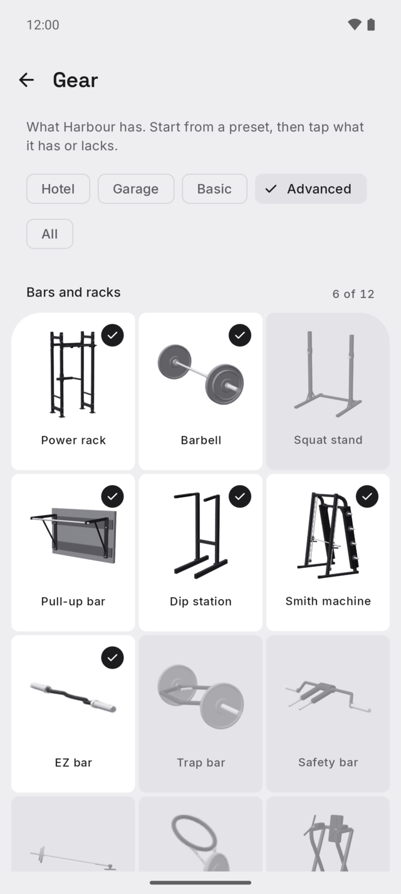
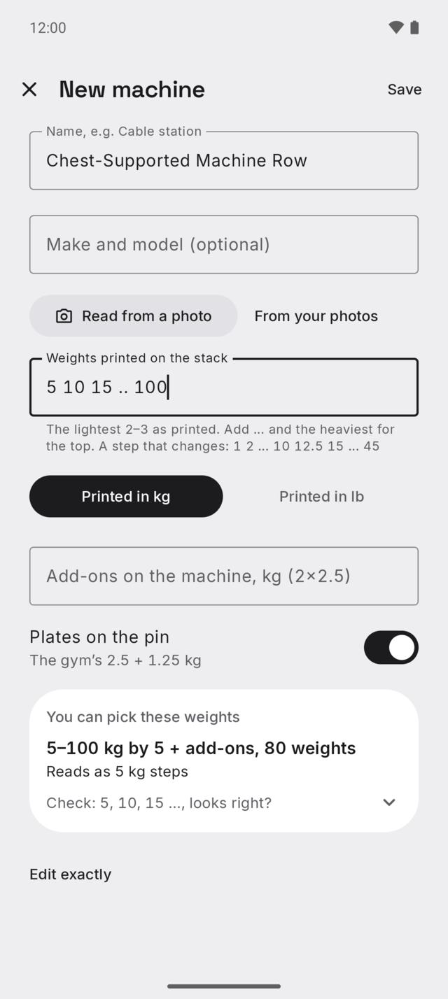

Cable stacks and machines differ between gyms, so Overload Vector keeps each gym's equipment and
the weights it can really be set to. Add and edit gyms in **Settings → Gyms and equipment**.

## Gear

**Gear** on a gym's screen is the list of equipment kinds it has. Start from a preset (Hotel, Garage,
Basic, Advanced or All) and tap what differs. Setup uses it to pick exercises you can do there.

## Equipment and weights

- **Stack machines**, cable stations included, have a pin stack in kg or lb, with add-on plates if
  they have them.
- **Plate-loaded machines** have their empty weight and use the gym's plates.
- **Bars** and the gym's **plates**, counted in pairs of each size.
- **Dumbbells:** the sizes on the rack.

You can type a stack's labels as a short list, such as `5 10 15 … 100`, or **read them from a
photo**. The phone reads the photo itself. If you'd rather, Claude reads it instead, with your
Claude key.

## Which machine?

You don't have to set everything up first. The first time you do a machine or cable exercise at a
gym, the app asks **Which machine?** Pick one, or add it, and it's remembered. If the gym has
nothing for the exercise, **Not at** the gym swaps it for another, now and next time.

All cable exercises at a gym share one **cable station**, so you set it up once.

A program's machines can be added in one go: on a gym's screen, **Add the equipment your program
uses**. Each one asks for its stack's labels the first time you use it.

## Training history by machine

Free weights share one history across your gyms. Machines and cables keep a history for each
machine, because a number on one stack doesn't mean the same on another. A new machine of the same
make and model as one at another gym can start from that one's weights.

## Units

Choose kg or lb in **Settings → Weight unit**. Stored weights don't change when you switch, and a
machine's pin and labels read as printed on it.

## Importing a gym

**Settings → Gyms and equipment → Import gym** reads a gym file and adds it as a new gym, without
changing the ones you have. Every problem in a file is listed, and nothing is added until it's
clean. The [gym file format](/docs/gym-format/) describes every field.
