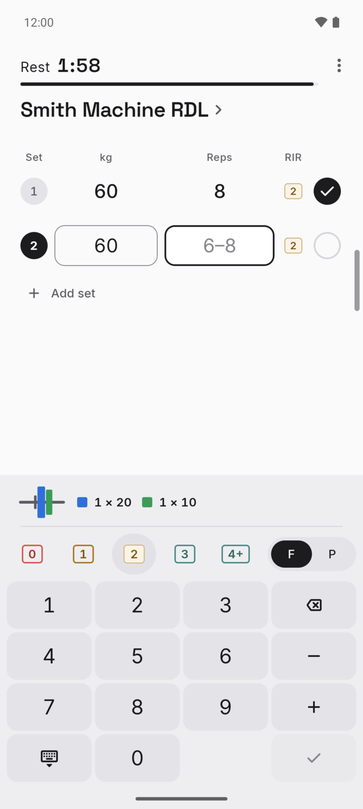
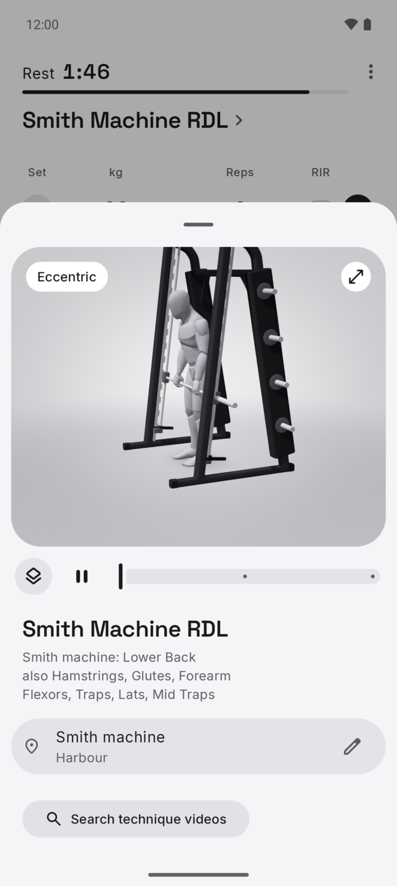

Every tap is saved at once. You can leave the app, lock the phone or restart it, and the session is
where you left it.

## Start

Tap **Start session** on Today. With more than one gym, pick the one you're at: the app suggests
the one you usually train at that day. If that gym lacks something the day needs, the sheet lists a
swap for it, which applies to this session only.

## The set table

You see one exercise at a time, with a row for each set: **kg** (or lb), **reps**, **RIR** and a
check.

- **Weight** is filled in with the app's [suggestion](/docs/progression/). Change it whenever you
  like.
- **Reps** are never filled in. The empty cell shows the target, such as `6–8`.
- **RIR**, reps in reserve, is how many more reps you could have done: `0` is to failure, `2` means
  two left. It starts at the target. You can clear it, but a set without it doesn't move your
  suggestions.
- **The check** logs the set and starts your rest. A set done as planned is one tap once its reps
  are in.

Type with the number pad at the bottom. A weight that looks like a typo, such as ten times the last
set or one your equipment can't make, is questioned before it's logged: pick a suggested weight, or
tap the check again to keep yours.

To fix a logged set, tap it, change it and tap the check. Tap a set's number to remove it or change
its target, and **Add set** to do one more.

## Partial reps

Press **P** on the pad to split the reps cell: full reps on the left, partials on the right. Partials
are recorded, but they don't count towards your estimates.

## Warm-ups

The app writes warm-up sets from your first work set's weight, rounded to what your equipment can
load. They are marked **W**, are optional and are never counted as training volume. For barbells and
plate-loaded machines, the pad also shows which plates go on each side.

## Rest

Rest starts when you log a set and runs at the top of the screen. Tap it to add or take off 15
seconds, or to end it. The phone vibrates when rest is over, also with the screen off, and a
notification shows the next set. Allow notifications to see it on the lock screen.

There's no rest between the two exercises of a superset, before a drop, or after an exercise's last
set.

## Moving between exercises

Swipe sideways, or tap the handle at the right edge, to open the exercise rail. It lists the
session's exercises with a dot for each set.

- **Tap** an exercise to do it now. The one you skipped comes back afterwards.
- **Hold and drag** to change the order for this session.

Tap an exercise's name for its details: the technique video, how the movement looks, the muscles it
works, your goal and trend, and **Swap** or **Remove** while nothing is logged on it.

An exercise on an adjustable bench has a **Bench** row above its sets. Tap it, then lay the phone on
the backrest to read the angle, or type it.

The first time you do a machine exercise at a gym, the app asks **Which machine?** and remembers
your answer. See [Gyms and equipment](/docs/gyms/).

## Intensity techniques

A set can carry one technique, from the program or picked during the session by tapping the set's
number.

| Technique | What you log |
| --- | --- |
| Drop set | Weight and reps for each drop; the app works out the drop weights |
| Myo-reps | The activation set, then reps for each mini-set, until one misses its target |
| Lengthened partials | Full reps, then as many partials as you can |
| Iso hold | Seconds held, with a timer, in the stretch or the contraction |
| To failure | The set, at 0 RIR |

## Changing today's plan

Add, remove, reorder or swap exercises and sets as you need. The changes apply to this session only.
To keep an exercise's change for the rest of the block, tap **Save changes** in its details and
accept what it shows you. Add an exercise from the **⋮** menu at the top.

## Finish

When every planned set is logged, tap **Finish session**; you can also finish early from **⋮**. The
summary lists any **records**: your best estimate on an exercise, or more reps than ever at a weight.
A session with nothing logged is dropped.

## Without a program

**Start session** also works with no program, or beside one as **Ad-hoc session**. Add exercises
from the library; each starts with one set, and **Add set** gives it more.

## Afterwards

**History** lists your finished sessions. Open one to correct a set you mistyped, and your
suggestions follow. **Progress** shows your sets per muscle each week, each exercise's trend, your
lift goals and your bodyweight.
