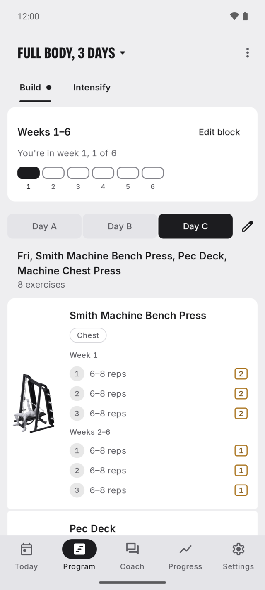
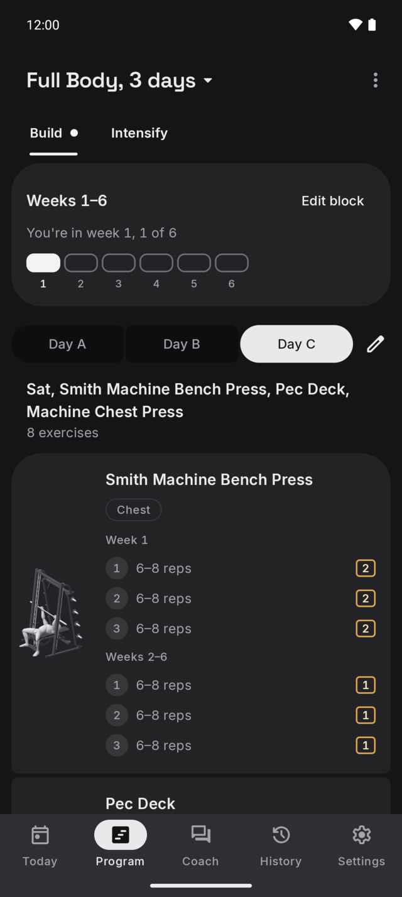

A program is blocks of weeks. Each block has days, and each day has exercises with their sets, rep
ranges, target reps in reserve (RIR) and rest. The program never prescribes a weight. Weights come
from [progression](/docs/progression/).

## Where programs come from

- **Setup** writes one for your week, your gym and your goal.
- **Overload Vector Full Body**, the starter program, comes with the app.
- **Claude** proposes one in a check-in or through the connector. See
  [Coaching with Claude](/docs/coaching/).
- **A program file**, which you import.

One program runs at a time. Starting another keeps the old one and its sessions.

## The Program tab

The tabs under the title are the blocks. Pick one to see its weeks, its days and each day's
exercises. Tap an exercise to edit it. Finished blocks have **Review**, a page on how the
block went. It shows your lifts, the sessions you turned up for, your volume and your records.

## Editing

You edit a block at a time:

- **An exercise's sets:** reps, RIR, technique, back-off, adding and removing sets.
- **A day's exercises:** swap, add, remove, reorder, and choose alternatives.
- **A block's days** (**Edit days**): add, remove, rename and reorder them.
- **Blocks:** add, remove, move, and make longer or shorter, with a planned deload week.

Weeks you've already trained keep what they were. A change to the block you're in starts from the
next day you haven't trained.

## Changes

The **⋮** menu on Program has four quick changes: **Skip day**, **Repeat week**, **Deload week**
and **Shift program**. These are **Changes**, as most of a coach's proposals are. You see what
differs before you accept, and you can revert them from the Changes page.

## Training days

With training days set, your program's days take turns on them. Three days on three training days
land on the same weekdays each week. Four days on three rotate. A missed day is skipped, and Today
offers to train it on a free day that week. A week with no sessions doesn't count, and the next week
runs it again.

Set the days, each day's gym and how many minutes you have from the pencil at the top of Today. When
a day is planned to run longer than you have, Today says so.

## Importing a program

Tap the program's title to open **Programs**, then **Import program**, and pick a `.json` file. With
no program running, **Import program** is on the Program tab itself.

The app checks the file first. If anything is wrong, it lists every problem with its place in the
file and imports nothing. If a program is running, choose **Start now** or **Save for later**.

The [program file format](/docs/program-format/) describes every field, so you can write a program
by hand or ask Claude to. **Export** on a program's sheet saves it as a file, which is also the
easiest example to start from.

## Your program list

**Programs** lists everything you have:

- **Running:** the one you're on.
- **Saved:** kept for later. Open one to read it, start it, export it or delete it.
- **Past:** earlier runs. **Resume** one where you left it, or **Run again** from week 1.
