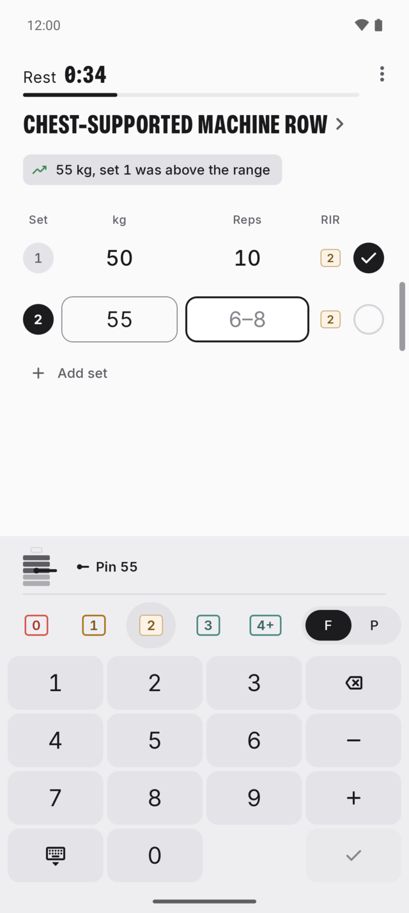
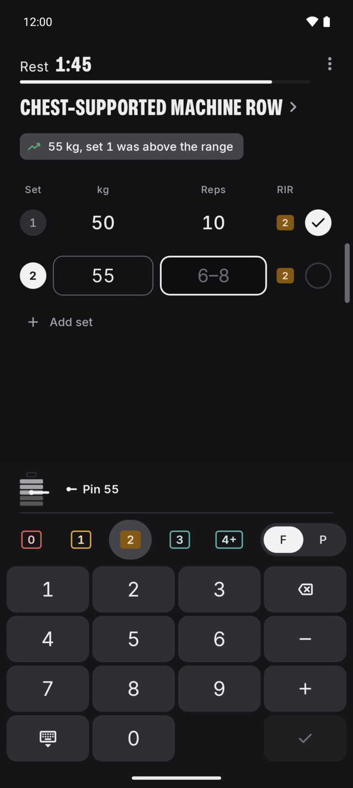

The app suggests a weight and a target for every exercise's next session. Type another weight if you
like. The next suggestion follows what you lifted.

## What it reads

The app judges your **work sets at the top weight** from the last time you did the same rep range of
that exercise. It counts reps and reps in reserve (RIR) together, so 11 reps with 1 in reserve is
as good as 10 reps with 2 in reserve.

It also keeps one **strength estimate** for each exercise, roughly the most you could lift once,
worked out from your sets of 12 reps or fewer. Machines and cables have an estimate for each
machine, because the numbers on one stack don't compare with another's. Squat and Deadlift have one
for each bar.

An exercise with no history gets no suggestion until you've logged its first set.

## The rules

| What happened last time | What the app suggests |
| --- | --- |
| Every set reached the top of the range at the target RIR | The next weight your equipment has |
| In the range, short of the top | Same weight, one more rep |
| One rep short of the bottom | Same weight |
| Two or more reps short | One step down |
| The next weight is too big a jump | Same weight, one more rep |
| A deload week | Last time's weight, at an easier target |

With a fixed rep target, beating it by one rep moves the weight up. When a block changes the rep
range, the weight comes from your estimate, marked "estimated, check it on the first set".

**Every suggestion is a weight you can load.** The app knows each machine's stack and your gym's
plates and dumbbells.

## During a session

The next set's weight follows the gap between your target and the RIR you logged, about 5% for each
point of RIR and at most 10%.

## Why it says what it says

Under the exercise's name, a short line gives the reason: "Up to 62.5 kg, you topped the range" or
"Stay at 40 kg, you were one rep short". Tap it to see last time's sets.

## Deloads, easy weeks and Changes

A deload week never lowers your estimate, and the app doesn't step the weight down after one.

With [training days](/docs/programs/#training-days) set, the first week back after two or more weeks
without training is an **easy week**, with one set fewer, one more rep in reserve and no techniques.

A coach's [Change](/docs/coaching/), such as 10% lighter after time off, applies on top of the
suggestion for as long as it lasts.

## Goals and records

Set a **lift goal** for an exercise's estimate from its trend on the **Progress** tab, with a date
if you like. A goal shows how far you are. It never changes your program or your suggestions. Goals
are for free weights and weighted bodyweight exercises.

A **record** is a new best estimate on an exercise, or more reps than before at a weight you've
lifted. The app marks the set.
