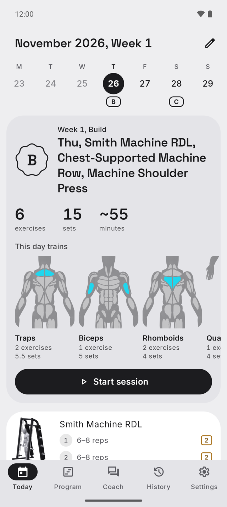
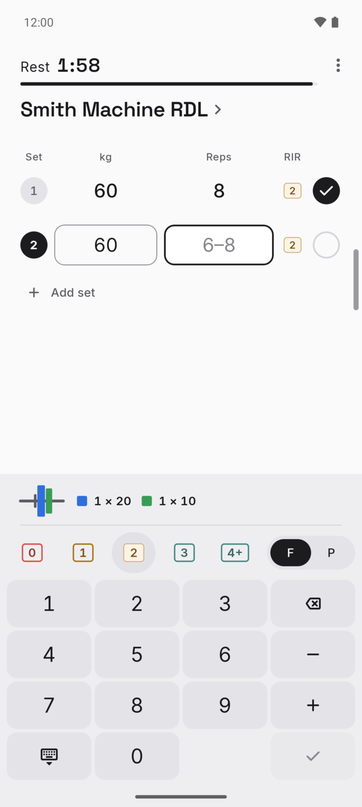
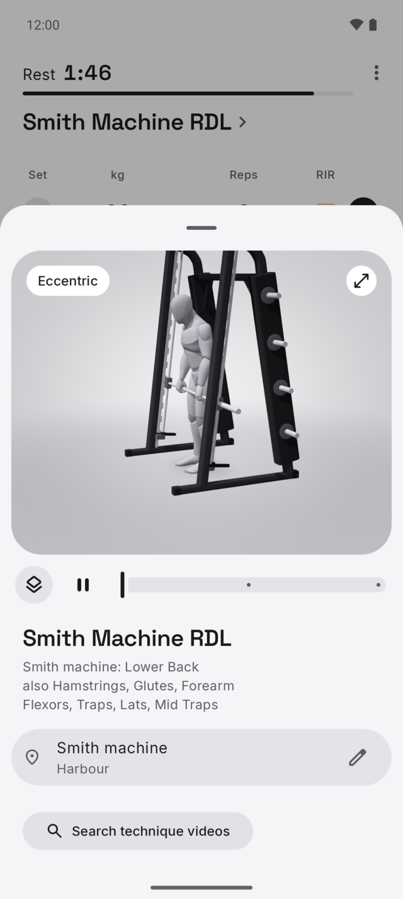
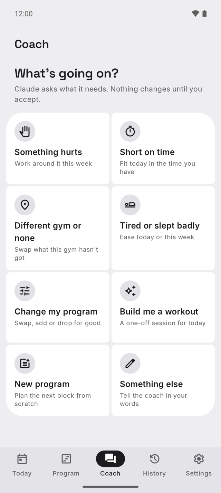
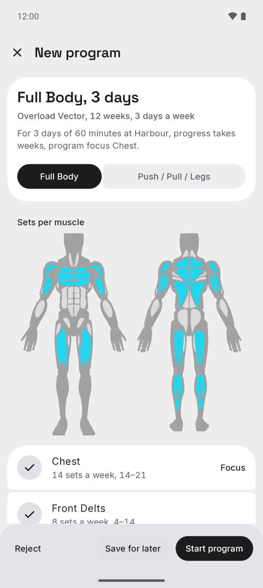
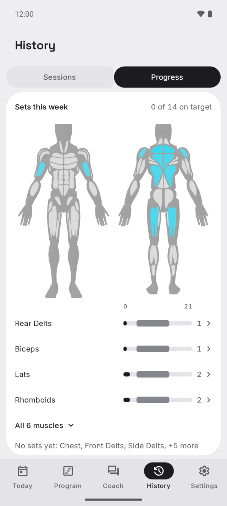

import { Card, CardGrid } from "@astrojs/starlight/components";

## What it does

<CardGrid>
  <Card title="Runs a periodized program" icon="list-format">
    Blocks of weeks, days and set targets. Setup writes a first program for your week and your gym,
    or you import your own.
  </Card>
  <Card title="Logs your sessions" icon="pencil">
    Weight, reps, reps in reserve, intensity techniques and rest, with warm-ups and plates worked
    out for you.
  </Card>
  <Card title="Moves the weights up" icon="up-arrow">
    Every exercise gets its next weight from what you did, using only weights your gym really has,
    and says why.
  </Card>
  <Card title="Coaches with Claude" icon="comment-alt">
    Sore wrist, short evening, hotel gym: Claude proposes what to change, and nothing changes until
    you accept it.
  </Card>
</CardGrid>

## Your training stays yours

No account, no ads and no trackers. Your training lives on your phone and leaves it only for what you
switch on. See the [privacy policy](/privacy/).

## The beta

Overload Vector is in beta and [free](/docs/free-and-full/). It runs on Android 8.0 or newer, on
64-bit ARM phones. [Install it](/docs/getting-started/), and tell us what you think at
[support@overloadvector.com](mailto:support@overloadvector.com).
